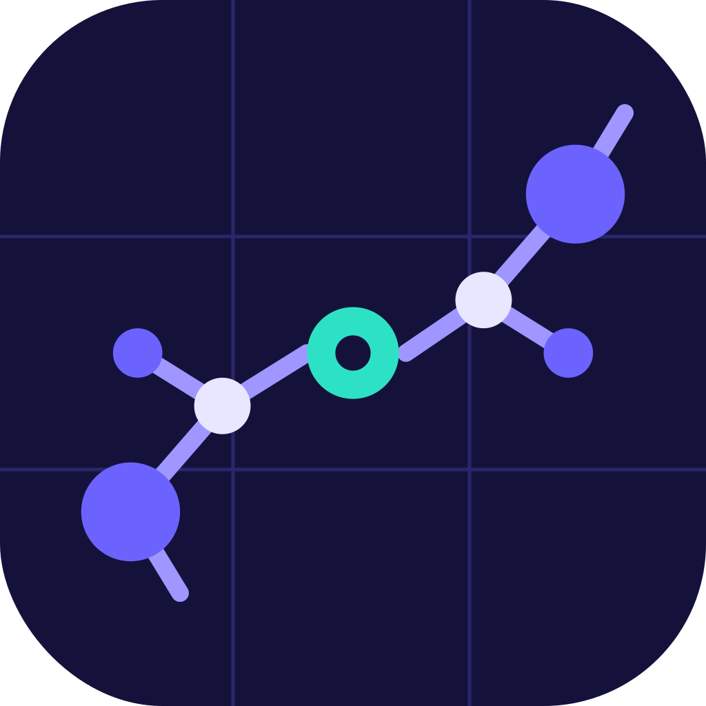
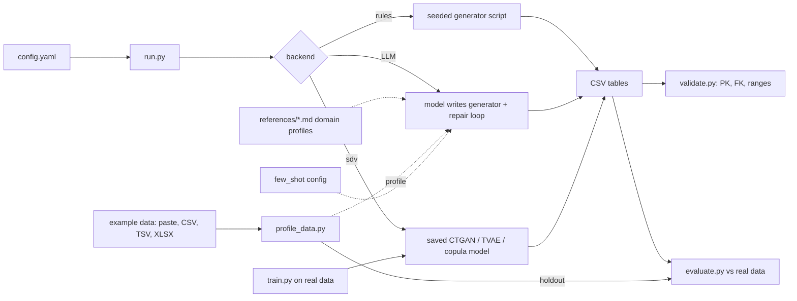

<p align="center">
  
</p>

<h1 align="center">Synapse: A Tabular Synthetic Data Agent</h1>

**Synthetic data agent for health and biomedical research (EHR, RNA-seq, wearables).** Synapse is a config-driven agent skill and Python toolkit that generates, trains, validates and evaluates synthetic datasets, and lets you swap the generator between rule-based code, large language models and classical machine-learning models (CTGAN, TVAE, Gaussian copula) so they can be benchmarked against each other.

> **Status: research prototype (v0.2.0).** Everything here is tested offline with fake LLM clients and generator-made data. Real LLM calls and real clinical, genomic or wearable datasets have not been tested yet. Synthetic data produced by Synapse is **not** real patient data and must not be used for medical or biological conclusions.

## Why

Comparing synthetic-data generators fairly is hard: they need the same schema, the same validation and the same quality metrics. Synapse provides one harness where the model and the API-key variable are configuration, quality is measured against real data with standard methods, and the domain knowledge (EHR, RNA-seq, wearables) is kept in editable reference files.

## Features

- **Swappable backends:** rule-based generator, Claude (Anthropic), OpenAI and any OpenAI-compatible server (Ollama, vLLM, OpenRouter), and SDV models (Gaussian copula, CTGAN, TVAE). See [docs/backends.md](docs/backends.md).
- **LLM agent loop:** the model writes a seeded generator script, Synapse runs and validates it, and errors are fed back for repair. Cost guards limit calls, tokens and repairs.
- **Few-shot from your own example data:** paste a table into the chat, or point Synapse at a CSV, TSV or Excel (XLSX) file. A profile of the sample (types, ranges, category mixes, missingness, correlations, keys, derived columns, size and privacy warnings) guides the generator, and a held-out part can be used to evaluate it. For API backends the same data goes in through a `few_shot` config with privacy guards. See [docs/example-data.md](docs/example-data.md).
- **Train, then sample:** fit CTGAN/TVAE/Gaussian copula once on real data, save the model, and sample any size later without the real data. Keys, foreign keys and derived columns are rebuilt so integrity holds by construction. See [docs/training.md](docs/training.md).
- **Evaluator:** fidelity (column shapes, pair trends, C2ST), utility (TSTR), privacy (distance to closest record and exact-copy rate), coverage and validity, and integrity, plus a leaderboard to compare runs. See [docs/evaluation.md](docs/evaluation.md).
- **Health and biomedical domain profiles:** EHR and disease classification, gene-level RNA-seq, and exercise and wearable data. See [docs/domains.md](docs/domains.md).
- **Works as a Claude skill:** drop the folder into `~/.claude/skills/synapse/` and use `/synapse`.

## Quick start

Requirements: Python 3.11+ (developed on Python 3.13 on Windows; CI also runs Python 3.11 and 3.13 on Linux).

```bash
git clone https://github.com/mahayasa/synapse.git
cd synapse
pip install -r requirements.txt            # numpy, pandas, scipy, scikit-learn, pyyaml
# optional, only for the backends you use:
pip install -r requirements-optional.txt   # anthropic, openai, sdv (sdv pulls in PyTorch), openpyxl (.xlsx)
```

Generate data with the rule-based backend (no model, no key) and validate it:

```bash
python run.py --config configs/rules.yaml --out out/demo
```

Run the offline test suite:

```bash
python -m unittest discover tests
```

Score synthetic data against real data, or compare several runs:

```bash
python evaluate.py --real data/real --synthetic out/run_a out/run_b --labels claude ctgan
```

Train a classical model on real data, then sample from it:

```bash
python train.py --config configs/ctgan.yaml
python run.py   --config configs/ctgan.yaml
```

Use an LLM backend (the config names the environment variable that holds your key, never the key itself):

```bash
# PowerShell:  $env:ANTHROPIC_API_KEY = "..."
# bash:        export ANTHROPIC_API_KEY="..."
python run.py --config configs/anthropic.yaml
```

Profile your own example data (CSV, TSV, pasted text or XLSX) and keep a part back for evaluation:

```bash
python profile_data.py data/real/my_patients.xlsx --exclude name email
python profile_data.py data/real/my_patients.xlsx --export data/real/prepared --holdout 0.3
python evaluate.py --real data/real/prepared/holdout --synthetic out/run_a
```

A complete worked example (a small diabetes classification table) is in [examples/diabetes_classification/](examples/diabetes_classification/).

## Use as a Claude skill

```bash
git clone https://github.com/mahayasa/synapse.git ~/.claude/skills/synapse
```

Start a new Claude Code session and run, for example, `/synapse generate a small diabetes classification table`. Skills load at session start. See [docs/getting-started.md](docs/getting-started.md).

**How the data is produced in a session.** Claude designs and writes a seeded generator script from the domain profile (and from your example data, if you give any) and runs it on your machine. The numbers come from that code, not from the model typing rows, so the same script and seed give the same file. The quality depends on the model that writes the script and on the knowledge it brings. Other generators, such as another LLM or CTGAN/TVAE trained on your real data, are selected through a config; see [docs/backends.md](docs/backends.md).

**Use your own example data.** Paste a table into the chat, or tell Claude the path of a CSV, TSV or XLSX file ("generate data like `data/real/my_patients.xlsx`"). Claude profiles the sample, uses it as few-shot guidance (the sample wins over the built-in domain profile, and it never copies your rows), and evaluates against it when there is enough data. Pasted or uploaded data is sent to Anthropic as part of the chat, so remove identifiers first and only use data you are allowed to share. Details: [docs/example-data.md](docs/example-data.md).

## How it fits together



More detail: [docs/architecture.md](docs/architecture.md).

## Repository layout

```
synapse/
├── SKILL.md              # the agent skill definition (process and rules)
├── run.py                # config-driven runner
├── train.py              # train a classical model on real data
├── evaluate.py           # score synthetic vs real, compare runs
├── profile_data.py       # profile example data (CSV/TSV/pasted/XLSX) for few-shot
├── backends/             # rules, LLM (Anthropic/OpenAI/compatible), SDV, few-shot, data reader
├── evaluation/           # metric implementations and reports
├── scripts/              # generator template and validate.py
├── references/           # health_ehr, biomedical_omics, exercise_wearables
├── configs/              # example configs for each backend
├── tests/                # offline unit tests
├── examples/             # worked example
└── docs/                 # full documentation
```

## Documentation

| Document | Contents |
|---|---|
| [Getting started](docs/getting-started.md) | Install, first runs, use as a Claude skill, troubleshooting |
| [Backends and configuration](docs/backends.md) | Every config key, API keys, few-shot, cost guards |
| [Example data (few-shot)](docs/example-data.md) | Paste or upload CSV/TSV/XLSX, the profile, holdout evaluation, privacy |
| [Training classical models](docs/training.md) | Train/sample workflow, key handling, derived columns |
| [Evaluation](docs/evaluation.md) | Metric definitions, how to read scores, caveats |
| [Domain profiles](docs/domains.md) | The three profiles, real data vs profile, adding a domain |
| [Security and privacy](docs/security-and-privacy.md) | Keys, sandboxing, pickles, sensitive data |
| [Architecture](docs/architecture.md) | Data flow and module responsibilities |
| [Extending](docs/extending.md) | Adding a backend (GAN, diffusion) |
| [Benchmark plan](docs/benchmark.md) | Research design for comparing generators |
| [Roadmap](docs/roadmap.md) | Known gaps and next steps |

## Limitations

- Offline tests pass in CI on Linux (Python 3.11, 3.13) and Windows (3.13) without sdv. SDV training was tested only on Windows with Python 3.13, using generator-made data. No real LLM calls, no real public datasets, no GPU timing yet.
- Few-shot from example data is tested offline with constructed samples only. A small sample teaches formats and rough distributions, not exact relationships, and cannot support a reliable evaluation.
- The evaluator targets flat and relational tables. Metrics for gene-by-sample matrices and sensor time series are not implemented.
- Classical models are not byte-reproducible; saved models are pickles.
- The privacy score is a distance heuristic, not a formal guarantee.
- Clinical and physiological values in the domain profiles are rules of thumb and have not been checked against sources.

## Contributing

See [CONTRIBUTING.md](CONTRIBUTING.md). Changes are listed in [CHANGELOG.md](CHANGELOG.md).

## License

MIT, see [LICENSE](LICENSE).
