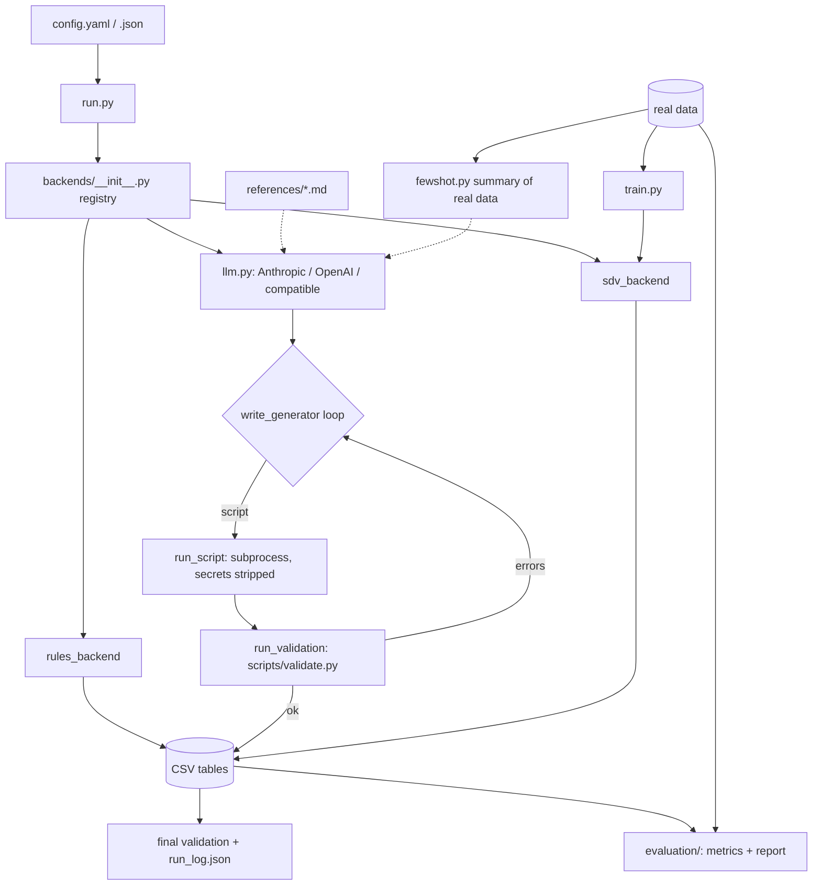

# Architecture

## Data flow

## Modules

| Path | Responsibility |
|---|---|
| `run.py` | Load config, pick backend, generate, validate, optionally evaluate, write `run_log.json` |
| `train.py` | Train and save a classical model (calls `backends/sdv_backend.train`) |
| `evaluate.py` | CLI for scoring and comparing runs |
| `backends/base.py` | `Backend` base class, `ConfigError`, `BudgetExceeded` |
| `backends/__init__.py` | Registry mapping backend names to classes; sets the Windows joblib workaround |
| `backends/common.py` | API-key lookup, secret scrubbing, running generated scripts, running validation, loading profiles |
| `backends/rules_backend.py` | Runs a seeded generator script |
| `backends/llm.py` | `LLMClient` adapters (Anthropic, OpenAI-compatible), budget-guarded calls, write-generator loop, direct-rows mode |
| `backends/fewshot.py` | Builds the few-shot summary of real data with privacy guards; also provides the column summaries used by `profile_data.py` |
| `backends/dataio.py` | Reads example data (CSV, TSV, pasted text, markdown tables, XLSX) into tables |
| `profile_data.py` | Profiles example data (keys, foreign keys, derived columns, correlations, warnings) and exports normalised CSVs with an optional holdout |
| `backends/sdv_backend.py` | Train, save, sample SDV models; rebuild keys, foreign keys and derived columns; held-out evaluation |
| `evaluation/metrics.py` | Metric implementations |
| `evaluation/report.py` | Per-table evaluation, composite score, markdown report, leaderboard |
| `scripts/generator_template.py` | Seeded skeleton generator with seasonality, skew, anomalies |
| `scripts/validate.py` | Generic CSV checks |
| `references/` | Domain profiles |
| `SKILL.md` | Skill definition: the agent's process and rules |

## Design decisions

- **Backends return files, not objects.** Every backend writes CSVs to a folder, so validation and evaluation are identical for rule-based, LLM and trained-model outputs. This is what makes generators comparable.
- **Keys are rebuilt, not learned.** Identifier and join structure is reconstructed from schema rather than modelled, so integrity is guaranteed by construction.
- **Config names secrets, never holds them.**
- **Optional dependencies are imported lazily.** The core runs with numpy, pandas, scipy, scikit-learn and PyYAML.
- **Real data is only read when explicitly configured** (`few_shot`, `evaluation`, `conventional.real_data`).

## Adding to the architecture

See [extending.md](extending.md). A planned refactor would move the shared training pipeline (key handling, derived columns, held-out evaluation) behind a small model-adapter interface so new GAN or diffusion models plug in without copying it.
